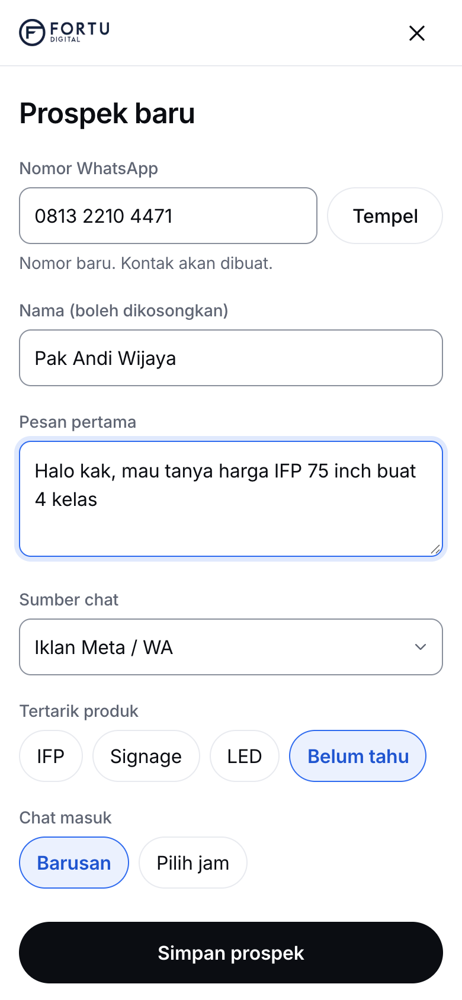
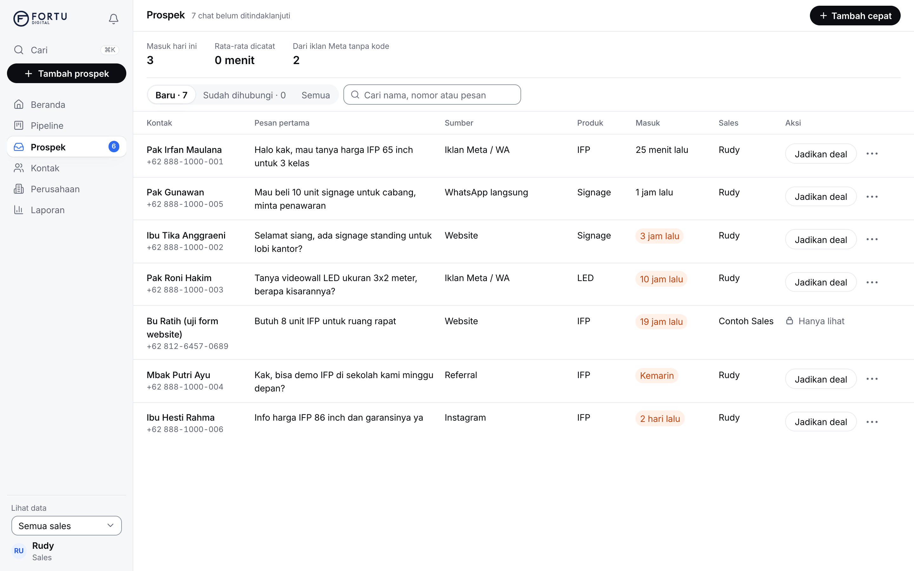
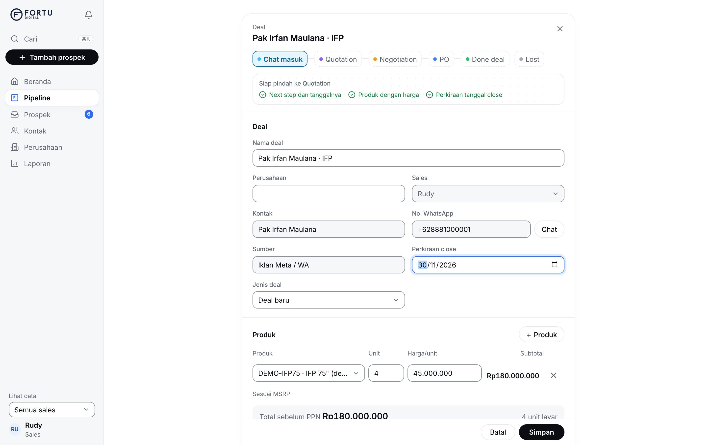
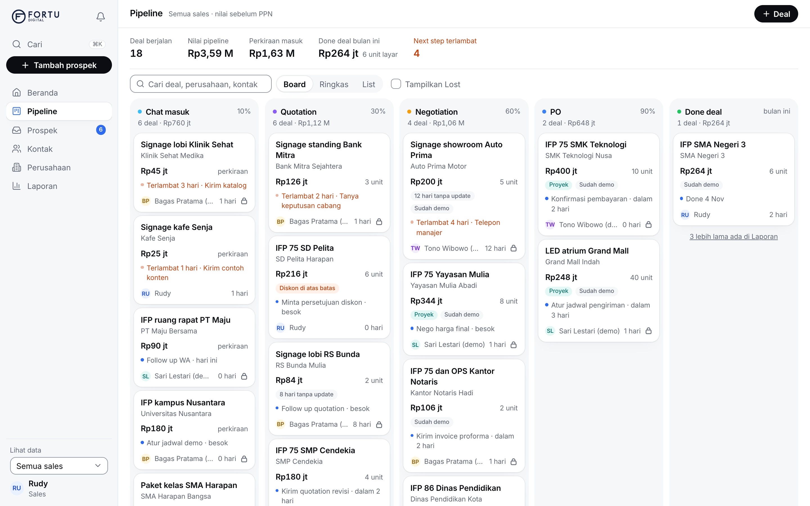
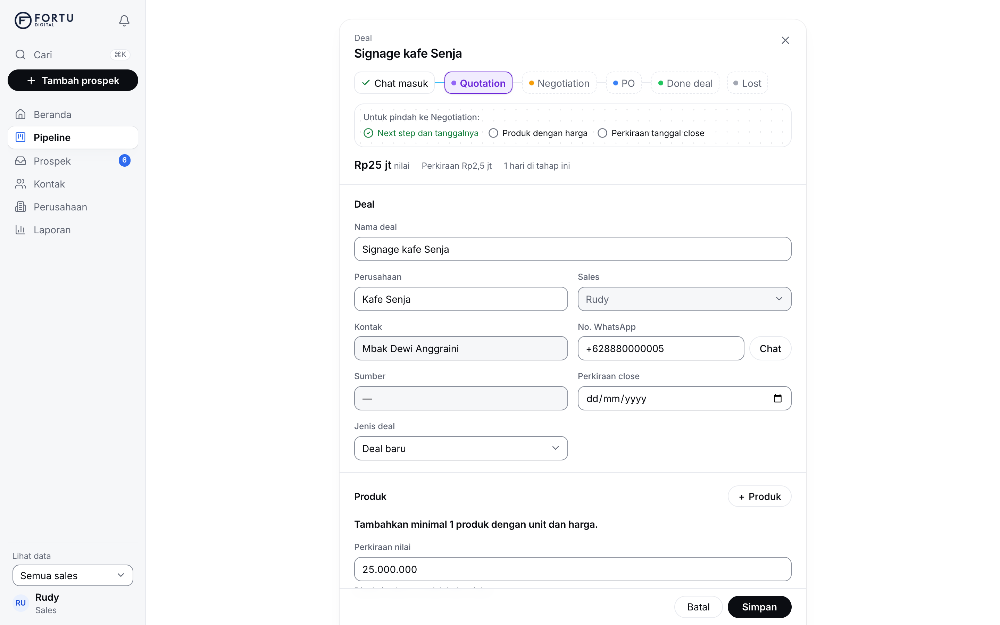
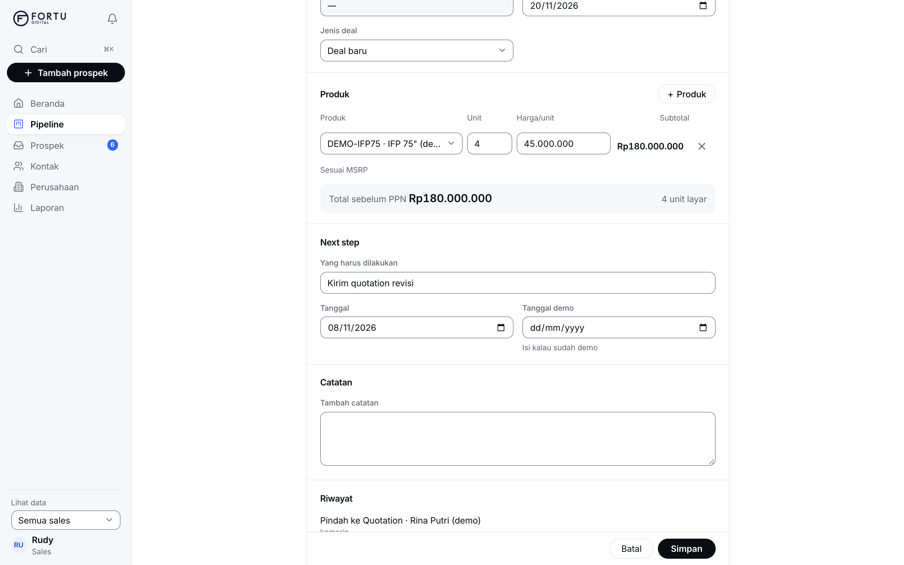
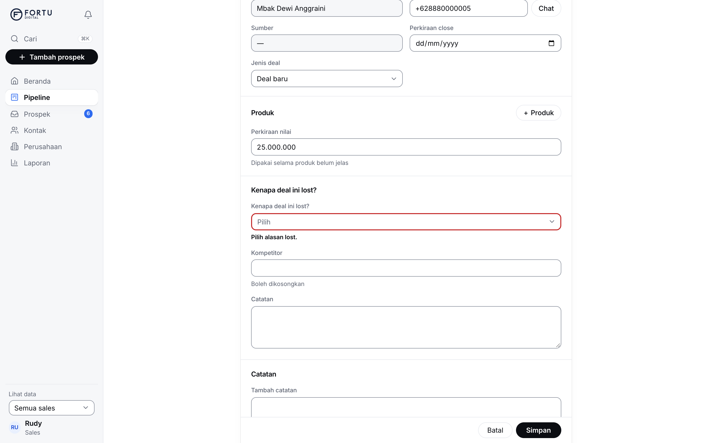

# Panduan Fortu CRM untuk sales

Satu halaman, lima hal yang kamu pakai setiap hari. Semua nilai di CRM adalah sebelum PPN. Gambar di bawah memakai data contoh.

## 1. Tambah cepat

Ada chat baru di WhatsApp? Catat di CRM, kurang dari 15 detik. Di HP, buka **Tambah prospek** dari menu.

1. Isi **Nomor WhatsApp**. Kalau nomornya sudah ada, CRM bilang "Kontak lama" dan menggabungkannya.
2. Isi nama kalau tahu, lalu tempel **Pesan pertama**. Kalau ada kode iklan di pesan, misalnya `[F-IFP-01]`, sumber dan produk terisi sendiri.
3. Pilih **Tertarik produk** dan jam chat masuk (Barusan atau Pilih jam).
4. Tekan **Simpan prospek**. Kolom nomor langsung kosong untuk chat berikutnya.

## 2. Jadikan deal

Chat yang serius jadi deal. Buka **Prospek**, cari barisnya, tekan **Jadikan deal**.

Nama, kontak, dan sumber sudah terisi. Tinggal:

1. Tekan **+ Produk**, pilih produk, isi **Unit**. Harga/unit terisi dari MSRP. Nilai deal mengikuti produk, jangan diketik sendiri.
2. Isi **Perkiraan close** dan **Next step** (lihat bagian 4).
3. Tekan **Simpan**.

Kalau diskon lebih besar dari batas (15% dari MSRP), muncul tanda **Diskon di atas batas**. Diskon itu perlu disetujui Pak Jovian.

## 3. Geser kartu

Buka **Pipeline**. Setiap kartu adalah satu deal. Tahapnya: Chat masuk, Quotation, Negotiation, PO, Done deal, dan Lost.

- Di komputer, tarik kartu ke kolom berikutnya. Di HP, pakai pilihan **Pindah ke tahap** di kartu.
- Kartu dengan ikon gembok milik sales lain. Kamu bisa melihatnya, tapi tidak mengubahnya.
- Kartu tidak mau pindah? Panel deal terbuka dan kolom yang kurang diberi tanda. Isi, lalu **Simpan**.

Syarat tiap tahap:

| Tahap | Harus ada |
| --- | --- |
| Quotation | produk dengan unit dan harga, perkiraan close |
| Negotiation, PO | produk, perkiraan close |
| Done deal | tanggal pembayaran |
| Lost | alasan lost |

## 4. Next step

Setiap deal yang berjalan punya **next step** dan tanggalnya: apa yang kamu lakukan berikutnya dan kapan.

- Selesai satu langkah, langsung ganti dengan yang berikutnya.
- Lewat tanggalnya, kartu berubah oranye: "Terlambat 2 hari". Itu satu-satunya hal yang oranye di CRM.
- Deal 2 sampai 14 hari tanpa update (tergantung tahap) diberi tanda "hari tanpa update".

## 5. Lost

Deal batal? Jangan dihapus. Buka deal, pilih tahap **Lost**, lalu **Kenapa deal ini lost?**

Pilih alasannya, isi kompetitor kalau tahu, lalu **Simpan**. Alasan lost dipakai tim untuk belajar dari deal yang lepas. Tidak perlu next step lagi.

## Kalau bingung

- **Cari** (atau Cmd+K di komputer) menemukan deal, kontak, dan perusahaan.
- **Beranda** menampilkan yang perlu perhatian hari ini.
- Lonceng berisi pengingat, misalnya next step yang terlambat.
- Ada yang aneh atau tidak bisa disimpan? Kirim tangkapan layar ke Sales Manager atau Adib.
